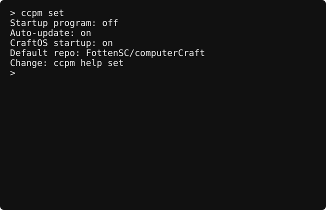

# ccpm for CC:Tweaked

This is a personal project.

Install programs and libraries from GitHub, keep their dependencies at exact commits, and choose what runs at boot. Updates activate only after all package files download and pass validation.

## Try the launch candidate

The first stable release is pending in-game acceptance testing. Use the development source to test this candidate on a computer or turtle:

```text
wget run https://raw.githubusercontent.com/FottenSC/computerCraft/v1.0.0-rc.1/bootstrap.lua --version 1.0.0-rc.1
```

Boot settings captured from the CraftOS-PC smoke test:



This installs **the manager only**. It does not install a program, change your CraftOS startup setting, or reboot. Existing `/startup.lua` and unrelated startup scripts are preserved.

Enable the HTTP API on your server and allow `api.github.com` and `raw.githubusercontent.com`. Release-asset installation also needs `github.com` and `release-assets.githubusercontent.com`. The tested emulator baseline is CraftOS-PC 2.8.3; the Minecraft target is CC:Tweaked 1.119.0 in FTB Skies 2: Aero 1.13.0. Older CC:Tweaked versions are currently unverified; the old 1.88 minimum is no longer a tested support claim.

After a stable release is published, the public installation command will be:

```text
wget run https://github.com/FottenSC/computerCraft/releases/latest/download/bootstrap.lua
```

Without source options, bootstrap and `ccpm self-update` select the latest published stable release. They never silently fall back to `main`. You can select `--version 1.0.0` once that tag exists, or `--commit` followed by a full 40-character SHA. Package installs default to the manager's recorded source; other repositories default to their latest stable release. Use `--branch main` explicitly for development.

## Choose a package

```text
ccpm available
ccpm install block-checker
ccpm info block-checker
```

`block-checker` requires a turtle and **digs the block below it unless that block is on its allow-list**. Inspect its configuration before running it. The defaults protect stone and monazite stone ore. Install it in a safe test area first. For example, configure blocks it must preserve from the CraftOS Lua prompt:

```lua
settings.set("blockChecker.allowed_blocks", {"minecraft:stone", "minecraft:chest"})
settings.set("blockChecker.delay", 0.5)
settings.save()
```

Exit the Lua prompt, then run it deliberately:

```text
ccpm run block-checker
```

Hold **Ctrl+T** to stop. Libraries such as `ccpm-log` install automatically as dependencies and cannot run on their own. Other repositories work with `ccpm available --repo owner/repo` and `ccpm install name --repo owner/repo`; add source options when needed.

## Choose boot behavior

```text
ccpm set
ccpm set startup block-checker
ccpm set auto-update on
ccpm set startup off
```

No program is selected by a fresh manager installation. Selecting a program saves that choice for the next boot; it does not launch it immediately. `ccpm install name --startup` combines installation and selection. Bootstrap also accepts an optional package plus `--startup` and `--reboot`, each explicitly requested.

Reinstalling preserves saved ccpm settings, including an existing startup selection. Inspect `ccpm set` before rebooting an upgraded computer.

ccpm installs `/startup/10-ccpm.lua`. CraftOS runs a user `/startup.lua` first, then startup directory scripts sequentially; a program that loops in your existing startup can prevent ccpm from running. Keep only one long-running boot program, or arrange your own startup orchestration. If CraftOS startup is disabled, enable it with `set shell.allow_startup true`. `ccpm doctor` reports both settings and startup conflicts.

Automatic updates apply to stable releases and explicitly tracked branches. Version and commit pins stay fixed. To follow development or pin a release:

```text
ccpm track block-checker main
ccpm pin block-checker --version 1.0.0
ccpm update
```

## Recover, diagnose, or remove

```text
ccpm version
ccpm info block-checker
ccpm doctor
ccpm rollback block-checker
ccpm prune --dry-run
ccpm prune
ccpm remove block-checker
ccpm uninstall
```

`doctor` works offline and prints versions, source commits, boot settings, cache health, and the last recorded command failure. Copy its output into a [bug report](https://github.com/FottenSC/computerCraft/issues/new/choose).

`rollback` activates the previous cached installation and its dependencies without downloading anything. It pins that commit so the next reboot cannot immediately undo the rollback. Use `track` to resume branch updates. A failed boot update runs the existing locked version. Failed state or runtime activation is recovered from a journal on the next command or boot.

`prune` removes unused, recognized package cache directories and preserves every active and previous dependency graph. Preview with `--dry-run`. Removing a package disables its boot selection and keeps its cache until pruning. `uninstall` removes the manager and its owned boot hooks, preserving your startup files, settings unrelated to ccpm, and package cache. Reinstall bootstrap to reuse that cache.

The previous manager and hook remain in `/.ccpm/previous-runtime/` after self-update. If the manager cannot run, back up `/ccpm.lua` and `/startup/10-ccpm.lua`, then copy the corresponding previous-runtime files back to those paths. This is separate from package rollback. An old ccpm-owned `/startup.lua` is migrated to `/.ccpm/legacy-startup.lua`; unrelated startup files are never replaced. Startup files overwritten by versions predating this change cannot be recovered without your own backup.

For HTTP failures, check the server's HTTP setting and host allow-list. GitHub rate limits can temporarily prevent branch/tag resolution; cached programs and rollback continue to work offline. A regular file at `/startup` prevents hook installation: back it up, then move it to `/startup.lua` if that path is free. ccpm refuses conflicting manager or hook paths and leaves them intact.

Run `ccpm help` or `ccpm help <command>` for command details. Help and package listings pause at the bottom of small computer and turtle screens.

## Contribute

See [development and package manifests](docs/development.md), [testing and releases](docs/testing.md), [contributing](CONTRIBUTING.md), and the [changelog](CHANGELOG.md). Downloaded third-party API references retain their upstream notices and are not included in the distribution.
